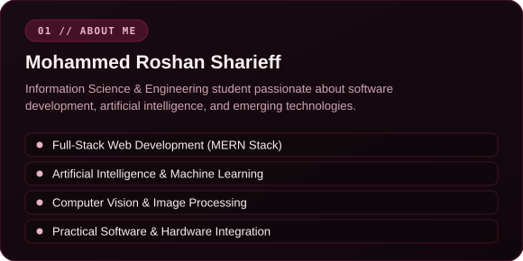
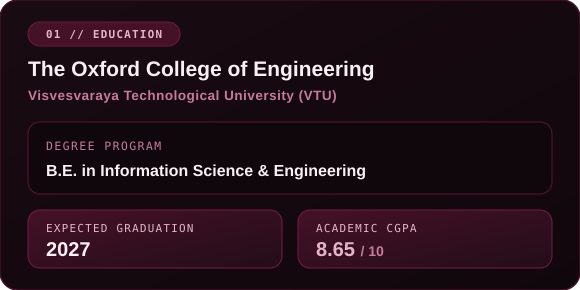
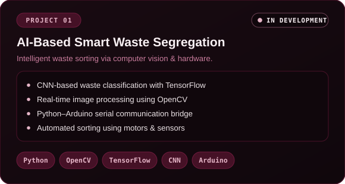
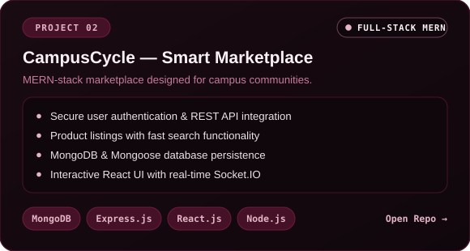
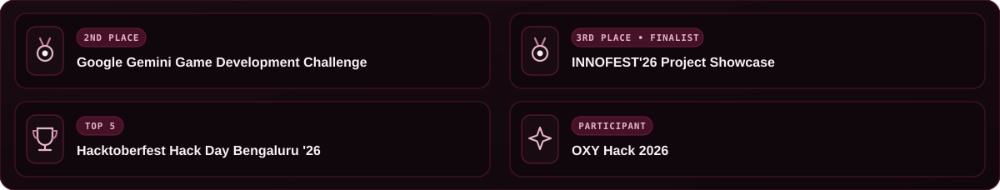

  

  

  
  
  

 

<!-- 01 // ABOUT ME & EDUCATION BENTO GRID -->
<table>
  <tr>
    <td width="50%" valign="top">
      
    </td>
    <td width="50%" valign="top">
      
    </td>
  </tr>
</table>

 

<!-- 02 // TECH STACK & TOOLKIT -->

  

<table>
  <tr>
    <td width="50%" align="center" valign="top">
       
      <strong>Programming Languages</strong>  
        
      Java &nbsp;•&nbsp; JavaScript &nbsp;•&nbsp; Python
        
    </td>
    <td width="50%" align="center" valign="top">
       
      <strong>Frontend Development</strong>  
        
      HTML5 &nbsp;•&nbsp; CSS3 &nbsp;•&nbsp; React.js
        
    </td>
  </tr>
  <tr>
    <td width="50%" align="center" valign="top">
       
      <strong>Backend &amp; Database</strong>  
        
      Node.js &nbsp;•&nbsp; Express.js &nbsp;•&nbsp; MongoDB
        
    </td>
    <td width="50%" align="center" valign="top">
       
      <strong>AI / ML &amp; Computer Vision</strong>  
        
      TensorFlow &nbsp;•&nbsp; OpenCV &nbsp;•&nbsp; CNN
        
    </td>
  </tr>
  <tr>
    <td colspan="2" align="center" valign="top">
       
      <strong>Development Tools &amp; Hardware</strong>  
        
      GitHub &nbsp;•&nbsp; VS Code &nbsp;•&nbsp; Arduino
        
    </td>
  </tr>
</table>

 

<!-- 03 // FEATURED PROJECTS -->

  

<table>
  <tr>
    <td width="50%" align="center" valign="top">
      
        
      
    </td>
    <td width="50%" align="center" valign="top">
      
        
      
      
      
    </td>
  </tr>
</table>

 

<!-- 04 // ACHIEVEMENTS & MILESTONES -->

  

  

<!-- 05 // GITHUB ANALYTICS & ACTIVITY -->

  

  

 

  

 

<picture>
  <source media="(prefers-color-scheme: dark)" srcset="https://raw.githubusercontent.com/roshanshariff422/roshanshariff422/output/github-contribution-grid-snake-dark.svg">
  <source media="(prefers-color-scheme: light)" srcset="https://raw.githubusercontent.com/roshanshariff422/roshanshariff422/output/github-contribution-grid-snake.svg">
  
</picture>

  

<!-- FOOTER -->

  
  

 

  

**Thanks for visiting my profile!**

